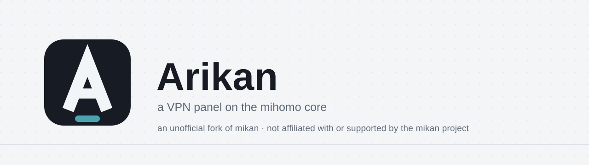

<div align="center">

<picture>
  <source media="(prefers-color-scheme: dark)" srcset=".github/assets/banner-en-dark.svg">
  
</picture>

<br>

**یک پنل VPN سریع و زیبا بر پایهٔ هستهٔ [mihomo](https://github.com/MetaCubeX/mihomo) — نصب با یک فرمان، بدون نیاز به نگه‌داری.**

[](https://github.com/o0hhs/arikan/releases)
[](https://github.com/o0hhs/arikan/pkgs/container/arikan)
[](LICENSE)

[English](README.md) · [Русский](README.ru.md) · [简体中文](README.zh-CN.md) · **فارسی** · [Türkçe](README.tr.md) · [Español](README.es.md)

</div>

---

> [!IMPORTANT]
> **فورک غیررسمی.** Arikan وابسته به پروژهٔ mikan نیست و توسط آن پشتیبانی نمی‌شود. پشتیبانی فقط از سوی نویسندهٔ فورک است.

## درباره

Arikan یک فورک غیررسمی از [mikan](https://github.com/Miroshka000/mikan) است: همهٔ امکانات نسخهٔ اصلی، به‌همراه برنامهٔ معرفی، برچسب کمپین‌های تبلیغاتی، دامنهٔ اختصاصی اشتراک، کپی پروتکل‌ها و VK TURN. توضیح کامل در [README.md](README.md) (انگلیسی) و [README.ru.md](README.ru.md) (روسی) آمده است.

## نصب

روی سروری تازه با Ubuntu 22.04+ یا Debian 12+ (amd64 یا arm64):

```bash
curl -fsSL https://github.com/o0hhs/arikan/releases/latest/download/install.sh | sudo bash
```

پس از نصب، هر زمان `arikan` را اجرا کنید تا منوی مدیریت باز شود.

## مجوز

Arikan فورکی از mikan است؛ نرم‌افزار آزاد تحت [GNU GPL v3](LICENSE) با شرایط افزودهٔ [NOTICE.md](NOTICE.md). حق نشر (C) 2026 Miroshka and Mikan. دربارهٔ موضع پروژهٔ اصلی در قبال فورک‌ها، بخش «Forks and third-party builds» در [README.md](README.md) را ببینید.
