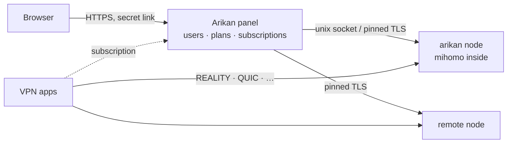

<div align="center">


<br>

**A fast, beautiful VPN panel on the [mihomo](https://github.com/MetaCubeX/mihomo) core — one command to install, nothing to babysit.**

[](https://github.com/o0hhs/arikan/releases)
[](https://github.com/o0hhs/arikan/pkgs/container/arikan)
[](LICENSE)
[](https://github.com/MetaCubeX/mihomo)

**English** · [Русский](README.ru.md) · [简体中文](README.zh-CN.md) · [فارسی](README.fa.md) · [Türkçe](README.tr.md) · [Español](README.es.md)

<sub>A fork of [mikan](https://github.com/Miroshka000/mikan): everything upstream has, plus a referral programme, ad agents, tariffs and a bot of its own, CDN presets, node diagnostics and much more — see [What this fork adds](#what-this-fork-adds). This fork releases on its own, signed with its own key.</sub>

</div>

---

> [!IMPORTANT]
> **An unofficial fork.** Arikan is not affiliated with or supported by the mikan project. Support comes only from the fork's author.

## Install

On a fresh Ubuntu 22.04+ or Debian 12+ server (amd64 or arm64):

```bash
curl -fsSL https://github.com/o0hhs/arikan/releases/latest/download/install.sh | sudo bash
```

The installer asks for the panel language and an optional domain, checks that the domain points to the server, installs Docker if needed, picks REALITY camouflage sites next to your server and prints your admin link. Run `arikan` again at any time for the management menu.

A node for an existing panel: the panel's **Nodes** page (or `arikan node add`) gives the command with its key:

```bash
curl -fsSL https://github.com/o0hhs/arikan/releases/latest/download/install.sh | sudo bash -s -- --join KEY
```

Without questions, for scripts: `… | sudo bash -s -- --yes --lang en --domain vpn.example.com --email you@example.com` (all flags: `arikan install --help`).

### Moving from stock mikan

Already running the upstream panel? Switching is just the image swap: your data stays as it is. The fork adds only new tables of its own (all of them empty — nothing existing is rewritten), and the panel applies the missing migrations itself at the first start.

**1. Stock mikan.** If no panel is installed yet, do the regular install first — it also sets up Docker, the firewall and compose:

```bash
curl -fsSL https://github.com/Miroshka000/mikan/releases/latest/download/install.sh | sudo bash
```

**2. Switching to the fork.** One command — it takes the newest stable release from the fork's signed release index and checks its signature:

```bash
curl -fsSL https://raw.githubusercontent.com/o0hhs/arikan/main/scripts/install-fork.sh | sudo bash
```

A panel older than 0.5.0.0 (still on SQLite) is updated to 0.5.x by the stock installer first: this script works with a panel on PostgreSQL.

A **node** (a server where `/opt/mikan/compose.yaml` runs only the `node` service) moves with the same command: there is no panel, no postgres and no pg_dump there, and the script knows it. It reads the role from `MIKAN_MODE=node` in `/opt/mikan/.env`, and from the compose file itself when that line is absent. On a node the backup is an archive of its own data (`/opt/mikan/data/node/backup/backup-<date>-before-fork.tar.gz`: keys, settings, connections) instead of a database dump, the schema and the `referral_*`/`campaign_*` tables are not checked (the panel creates them on its side), and updates are driven by the panel from its **Nodes** page. If the panel answers on several addresses and the node does not guess the right one, add `--node-panel-address IP`.

What `scripts/install-fork.sh` does:

- reads the fork's release index and manifest, checks both with the fork's signing key and takes the image from them, pinned to its digest (`--image ghcr.io/o0hhs/arikan:<tag>` names another image: a beta or your own build);
- pulls the image first: if something is off (the package is not public yet, no registry access) nothing is changed, the stack keeps running;
- puts the fork's command and its update units on the host **before** anything is switched, and only then turns the stock updater off: the stock command stays at `/usr/local/bin/mikan.stock`, the stock units' files stay on disk. Without this the panel's **Update** button and the nightly timer would still go upstream, and the day upstream publishes above the fork it would pull stock mikan over it;
- backs up — the database (pg_dump) on a panel, the node's data (tar) on a node — and keeps a copy of `.env`;
- switches the image and restarts the stack, naming the service by role (`panel` or `node`) and checking first that such a service is in `compose.yaml` at all;
- on a panel it verifies the database schema and the counts of users, plans and payments; on a node that it answers with its own command; in both cases that the host's updater is the fork's: a failed check rolls everything back by itself;
- leaves auto-update on: the fork has its own release repo and its own signing key, so the panel will not "update itself" back to upstream. The `--disable-auto-update` flag is only for older fork builds whose release repo still pointed at upstream.

Preview the script's plan without touching anything: the same request with `--dry-run`. If the image does not pull, make the package public: GitHub → Packages → arikan → Package settings → Change visibility → Public (the script prints this hint when it happens).

**3. After the switch.** Turn the programme on (**Payments → Referrals**) and create campaign tags on the **Payments** page. Everything else — users, plans, payments, nodes, subscription links — stays as it was.

**Rolling back to stock mikan** is the same script with the backup taken before the switch (payments, users and plans return to the state of that moment; the referral programme and campaign tag data is not part of that backup). The stock command and its update units come back with it:

```bash
curl -fsSL https://raw.githubusercontent.com/o0hhs/arikan/main/scripts/install-fork.sh | sudo bash -s -- --rollback /opt/mikan/data/panel/backup-<date>-before-fork.dump
```

On a node the backup is an archive of its data, and the rollback is named the same way (the script goes by the extension: `.dump` is a panel, `.tar.gz` is a node):

```bash
curl -fsSL https://raw.githubusercontent.com/o0hhs/arikan/main/scripts/install-fork.sh | sudo bash -s -- --rollback /opt/mikan/data/node/backup-<date>-before-fork.tar.gz
```

## What this fork adds

The official mikan lives at [Miroshka000/mikan](https://github.com/Miroshka000/mikan). This repository is a fork: the upstream panel with everything it does, plus the additions below. Upstream is followed closely — its releases are carried over here, so the upstream fixes and features appear here too (0.5.2.0 is in). What upstream has is left as it is; the fork only adds to it.

### Money, sales and subscribers

- **Referral programme** (Payments → Referrals): invites by a bot link, a referrer's internal balance, reward rules per plan. A reward is a run of ten days of the tariff the referee bought — the dearest payment first, never a cheaper tariff downgrading a dearer one — and Stars earn at the programme's `stars_rate`. More below.
- **Ad campaigns and agents** (Payments → Advertising): a tagged link per ad with the counters behind it, and an agent — a login and password of their own — earns a percent you set (1–100, snapshotted per payment) of the sales of the campaigns pinned to them. Agents see their own panel under a secret path of its own; payouts are a written record: a mistake is fixed by another record, never deleted. More below.
- **Access codes** (Payments → Promo codes): a code can open a tariff the shop hides — bought at its price, or given for free, as the code says.
- **A tariff of one's own**: the buyer assembles a plan — the term, the traffic, the devices — and the panel prices it from the tariff's base and the coefficients the admin set (Payments → Tariffs → the constructor card).
- **Device packs**: extra places are sold as packs (+2, +7), priced by the term; while a pack is on sale, the single-device purchase is not offered and not invoiced.
- **Partners** (Payments → Partners): the franchise's ground — a partner's sign-up code (`/start partner_<code>`), a commission percent and a balance with a ledger; every paid ruble order of a subscriber who came with the code credits the share, and a refund takes it back.
- **Plans deleted for good**: «Удалить навсегда» beside archiving; payments keep the plan's name, and a plan subscriptions are on is refused with the reason.
- **The admin hears of every payment**: a successful payment tells the bot's admins in their own chats — and the panel's alerts chat when one is connected — who bought, what, for how much, by which method and for how long.
- **Business analytics** (Analytics): revenue in rubles and Stars, MRR/ARR, ARPU/ARPPU/LTV, trial conversion, churn, retention cohorts, and revenue by plan, payment method and ad campaign for 30, 90 or 365 days.
- **Automation scenarios** (Automation): event → conditions → actions rules for every panel event, with a per-client cooldown, dry runs and a journal. Actions message an admin or client, extend a subscription, grant traffic, send an existing promo code, or create and send a one-use personal discount.
- **Webhooks to your site** (Settings → System): the panel sends signed events to your URL — `subscription.paid` with the subscription and payment, and the rest of the feed in a common envelope, including `payment.failed`. Delivery is retried with backoff, with a test button and a 7-day history.

### The bot

- **The bot ships with the panel**: the fork's own bot addon (`arikan-telegram`) is built into the image as a built-in source, signed with the release key the panel trusts anyway; the panel installs it and hands the bot over by itself, taking it over from the marketplace's bot where it set that one.
- **Colored buttons, premium emoji, per-button labels** (Telegram → Menu and texts): every built-in button takes Telegram's color (plain, blue, green, red), a premium emoji id, and an emoji or a label of its own.
- **The bot the buyer understands**: four buttons in the main menu; connecting hands the subscription to the app first — the one-tap import (`happ://`, `incy://`, `kabosu://` deeplinks) is the primary button and installing the apps is a screen of its own; the whole connect screen is the admin's (Telegram → Menu and texts → Connect screen).
- **/admin in the bot**, with roles: superadmin, support (finds a subscription by id/@username/payment and gives days, resets sessions, blocks), tech; sleeping trials go out as one mailing.
- **Promo codes are entered in the chat**; a term is measured in months; one way to sell device places; the community addon `mikan-subs-bot` works here.

### The panel

- **Material 3 Expressive**: the admin panel and the subscription page (the Mini App) are rebuilt on the new design language — color roles, shape, type and motion — and the picker gained twelve more themes (six light/dark pairs built with Google's tonal-palette algorithm) and Roboto Flex.
- **Performance mode**: the interface drops animations and the glass blur for a flat, instant look, and background polling slows — the browser's own choice.
- **The dashboard as the admin sets it up**: every card has its own switch; the date is written compact, with the time, or large with ticking seconds, in the reader's own zone.
- **A public monitoring page** (Settings → Security): an address of its own behind a password of its own (only its hash is stored), service-wide and never a subscriber; each block has its own switch, the sensitive ones are off until turned on.
- **Where clients go**: the panel sums each subscription's traffic by site and keeps it by day; a site is blocked from the client's card, and one button clears everything collected. It lives in Settings → Routing, beside the DNS.
- **The node's disk in the panel**: what the data directory takes, how much junk piled up, and a one-button clean; the updater prunes old release images itself after every successful update.
- **Permissions and approvals** (Settings → Admins, Approvals): custom roles with a set of permissions; client deletion, link reissue, refunds and database restore wait for a second admin. An approved action is claimed as «executing», so two admins cannot run it twice, and a failure returns it to «approved» for a safe retry.
- **S3 backups and restore from the panel** (Settings → System): an encrypted dump on a schedule to an S3-compatible bucket, retention, history, a manual run, and restore with a fresh pre-restore backup and a second admin's approval.
- **Client diagnosis** (a client's card → «Check connection»): term, traffic, devices, plan, available protocols, nodes and the subscription link itself — with the reason and a fix button. The check only reads and changes nothing.
- **The client's card tells more**: «Ноды и протоколы» names the node behind each protocol with the usage of the last hour; the card is as wide as the users list, sorts, and carries an «Open in Telegram» button.
- **Subscriptions from nodes**: the chosen nodes answer the subscription links themselves from the profiles the panel renders and pushes to them — a link keeps working while the panel's server is blocked or down. A record lives until the subscription's own end (or 30 days without a term), an expired one answers `410` in words a subscriber can act on, and a revoked one is gone within a minute.

### Nodes, network and blocking

- **CDN presets**: VLESS · TLS · XHTTP · CDN (the `stream-one` mode, with the client address in Behind a proxy) and the **GET-uplink** variant for the CDNs that refuse POST — Yandex included — which rides a small fork of the mihomo core. `scripts/cdn-check.sh` checks the chain layer by layer.
- **VK TURN** (a node card → ⋯ → VK TURN): where a whitelist lets only calls through, the node carries one of its protocols over the TURN servers of VK calls; in the subscription it appears once more — an ordinary-looking server at the client's own address.
- **Protocol copies** (Protocols → a protocol → Copy): raise the same protocol — the same keys, passwords and camouflage — on another port of the node or on another node, changing only the port and, for REALITY, the camouflage site.
- **Closed protocols per tariff**: an inbound switched off in the tariff stays out of every that-tariff client's subscription — off the nodes, so the app does not even try it — and the client's own per-user switches cannot open it.
- **Load balancing**: the subscription's auto group gained a third mode that spreads clients over the servers while keeping a destination on one server, so a session keeps its exit address.
- **The node says what is wrong**: its own internet check (egress) and uptime on the card, failed listeners with the reason and the busy-port hint, health transitions in the panel's log, and canceled requests logged quietly.
- **Emergency node and MTProto**: an expired subscription keeps the emergency node's servers alone — speed-capped, so Telegram stays reachable — and MTProto proxies for Telegram itself are one setting.
- **Anti-RKN hardening**: the node's API answers the panel alone (and `arikan doctor` says when it does not), port 80 answers 301, the node serves its own HTTPS page (also a REALITY camouflage target), and the docs have a hardening page.
- **Exit DNS on the node** for every client — domain rules and routing presets (Gemini among them) work for Xray-family apps too; a way out can be a share link; and a check shows where an exit really is by geobase.
- **Who goes through a node**: per-node clients with their traffic and last seen, and per-user nodes.
- **Finishing a panel move**: after a restore on a new server, `arikan admin migrate` sets the new address, keeps the subscription links and checks the nodes — they accept the moved panel without re-joining. The panel also hands out its own backup (Settings → System): the database dump downloads right from the panel.
- **An update channel of its own**: the image is `ghcr.io/o0hhs/arikan`, releases live on this page, the manifest is signed with the fork's key, and `arikan update` and the **Update** button fetch from here, not from upstream. Docs: [o0hhs.github.io/arikan](https://o0hhs.github.io/arikan).

How upstream feels about builds from other sources is said plainly in [Forks and third-party builds](#-forks-and-third-party-builds): check what you run, and run what you can read.

## Why Arikan

<table>
<tr>
<td width="50%" valign="top">

### 🛡️ Survives blocking on its own
Arikan watches whether real clients still reach each protocol. When a port gets blocked on the way, it moves the protocol to a free HTTPS port; when a REALITY camouflage site stops working, it picks a new one next to your server.

</td>
<td width="50%" valign="top">

### 📱 Every app gets what it can use
Subscriptions detect the app — Happ, v2RayTun, Koala Clash, SlothClash, Clash Verge, FlClash, ClashFest, Hiddify, Shadowrocket and more — and hand it only the protocols it actually supports. No more “it doesn't work for me”.

</td>
</tr>
<tr>
<td valign="top">

### 📊 Byte-exact accounting
mihomo is embedded as a library, so traffic is counted per user on every connection — not sampled. Plans by time and gigabytes, billing days, device limits and device binding against key sharing. Since every connection is known by its user, the torrent blocker bans the one who torrents on every node, not a shared IP.

</td>
<td valign="top">

### 🤖 Telegram bot and Mini App built in
Subscribers check their plan, devices and connection guides in a bot you set up in the panel, open the subscription page as a Telegram Mini App and get notified before it expires. They can also buy and renew — Telegram Stars, cards and SBP through YooKassa, or crypto through CryptoBot — and the panel hands out the link by itself. Broadcasts respect Telegram's limits.

</td>
</tr>
<tr>
<td valign="top">

### 🪶 Light as a feather
Go and PostgreSQL, three small containers. On a working server with clients: **~14 MB RAM** for the panel, **~50 MB** for the database, **~40 MB** for the VPN core.

</td>
<td valign="top">

### 🔒 Locked down by default
Secret admin link on a random port, HTTPS with Let's Encrypt (even for a bare IP), argon2id, TOTP 2FA, CSRF protection, strict CSP, audit log. Containers run non-root, read-only, with all capabilities dropped.

</td>
</tr>
<tr>
<td valign="top">

### 🌐 WARP and server cascades
Each node can have its own WARP — registered in one click or from your WireGuard config — and protocols can leave through another node of the panel (client → node A → node B → internet). Chosen protocols, domains and networks take those ways out, everything else goes direct.

</td>
<td valign="top">

### 🧩 API and keys for integrations
A REST API documented right in the panel, with read-only or full-access keys for bots, billing and monitoring.

</td>
</tr>
</table>

## Promo codes

Admins can create discount codes and codes for bonus days or traffic. Subscribers apply
codes in the Telegram Mini App, which also shows their redemption history. Bonus traffic
can go to the main balance or a selected pool. Discounted invoices are available only
through payment methods that support refunds: Telegram Stars and adapters that advertise
refund support. Arikan can then return a payment if its promo reservation expires before
the provider confirms it.

## Referral programme

Subscribers invite others with their own link (`t.me/<bot>?start=ref_<code>`). A Telegram
account belongs to one referrer for good, so an invitee is never counted twice. What a
referrer earns is set by rules the admin writes per tariff: a percentage into an internal
balance, bonus days onto their own subscription, or both, with a threshold rule that pays
on every N-th payment. The balance can pay for part of an invoice on its own. The admin
turns the programme on, writes the rules and picks the tariffs on the panel's **Payments →
Referrals** page.

## Ad campaign tags

Give each ad its own link (`t.me/<bot>?start=camp_<tag>`) and the panel counts, per
campaign, how many people arrived, how many bought and how many renewed. The stats live on
the same **Payments** page, so a campaign's payback is visible from the panel and not only
from the ad network.

## Protocols

Seventeen protocols, each a preset with keys generated for you. The subscription gives every app only what it runs:

| Protocol | Clash apps<br><sub>mihomo core</sub> | Xray apps<br><sub>Happ, v2RayTun</sub> | sing-box apps<br><sub>Hiddify, Karing</sub> |
|---|:---:|:---:|:---:|
| VLESS · REALITY · Vision | ✅ | ✅ | ✅ |
| VLESS · REALITY · XHTTP | ✅ | ✅ | — |
| VLESS · REALITY · gRPC | ✅ | ✅ | ✅ |
| VLESS PQ (post-quantum encryption) | ✅ | ✅ | — |
| Trojan · REALITY | ✅ | ✅ | ✅ |
| VLESS · TLS · XHTTP | ✅ | ✅ | — |
| VLESS · TLS · XHTTP · CDN | ✅ | ✅ | — |
| VLESS · TLS · XHTTP · CDN · GET uplink ² | ✅ | ✅ | — |
| VLESS · TLS · Vision | ✅ | ✅ | ✅ |
| Hysteria2 | ✅ | ✅ | ✅ |
| TUIC v5 | ✅ | — | ✅ |
| AnyTLS | ✅ | — | ✅ |
| TrustTunnel | ✅ | — | — |
| ShadowQUIC | ✅ | — | — |
| Mieru | ✅ | — | — |
| Shadowsocks-2022 ¹ | ✅ | ✅ | ✅ |
| Sudoku ¹ | ✅ | — | — |
| Snell ¹ | ✅ | — | — |
| VMess (custom config) | ✅ | ✅ | ✅ |

<sub>¹ One key for all users in mihomo: no per-user accounting or limits on these. Newer protocols are sent to Clash apps only when their core is new enough.
² The CDN presets are the fork's own, for operators where only a CDN's address is whitelisted: the client dials the CDN, the CDN's network reaches the node's origin over a separate connection. The GET uplink variant is for the CDNs that refuse POST (Yandex included): mihomo apps need 1.19.32+, the Xray family 26.3.27+.</sub>

## How it works



The panel and the node are two processes from one image. Update or restart the panel — VPN keeps running. Add remote nodes with a join key from the **Nodes** page.

## Managing the server

Run `arikan` for the menu, or use the commands directly:

| Command | What it does |
|---|---|
| `arikan status` | containers, versions, health, available update |
| `arikan logs [panel\|node]` | live logs |
| `arikan url` | admin link |
| `arikan reset-password` · `reset-path` · `disable-2fa` | regain access |
| `arikan update` | update now (backup first, automatic rollback) |
| `arikan backup` · `restore FILE` | backups in `/opt/mikan/backups` |
| `arikan admin migrate --public-host IP` | finish a panel move after a restore on a new server: new address, same links, nodes verified |
| `arikan node …` · `arikan inbound …` | nodes and protocols |
| `arikan targets scan` · `apply` | REALITY camouflage sites next to the server |
| `arikan join KEY` | on a node: take a new key from the panel |
| `arikan restart` | restart the containers |
| `arikan doctor` | check the server: Docker, ports, firewall, clock, DNS, disk |
| `arikan support CODE` | send diagnostics to a support ticket when the panel is down |
| `arikan support-access on\|off` | allow or forbid support access on this server |
| `arikan api-lockdown [status\|off]` | on a node: the state of the "node API from the panel's IP only" rule, or lift it at once |
| `arikan uninstall` | stop and remove the command, keep the data |

## Updates

The panel checks for a new release once a day and shows what changed. Turn on **auto-update** in settings, or press **Update**: the host updater pulls the image from GitHub Packages, backs up, migrates the database, restarts and rolls back if the new version does not come up healthy. Every release manifest is signed.

On 0.4.4 or older, update to 0.4.5 first; the move to 0.5 and PostgreSQL then comes through the Update button too. If you skipped 0.4.5, the install command above updates an existing server.

## Building from source

```bash
docker buildx build -t arikan:dev .            # panel + node image
cd web && pnpm install && pnpm dev            # admin UI with hot reload
MIKAN_TEST_DATABASE_URL=postgres://… go test ./...   # Go 1.27, a test PostgreSQL 18 and pg_dump
cd installer && cargo test                    # the installer (Rust)
```

Development happens on the `main` branch; pull requests are built and tested, releases are published from tags.

## ⛔ Forks and third-party builds

> [!CAUTION]
> **The official mikan lives only here:** the repository `Miroshka000/mikan`, the image `ghcr.io/miroshka000/mikan` and releases signed with the mikan key. Addons come only from the `getmikan/marketplace` catalog. Anything else is not mikan, whatever it calls itself.
>
> **The mikan project considers every fork and every build from other sources potentially unsafe.**
>
> **Official builds can be checked.** Every release is built automatically from the open code of this repository and signed, and the panel and the installer take updates only with that signature. What someone else's build is made of, only its author knows.
>
> **A fork does not get our updates.** It cannot sign releases with the mikan key, so fixes of bugs and vulnerabilities do not reach it until its author carries them over, if ever.
>
> **We do not support forks.** We do not review them and are not responsible for bugs, vulnerabilities or lost data in them. Questions about someone else's build are not handled in the chat or in issues.
>
> **The name is not part of the license.** GPL v3 covers the code, not the name mikan or its logo (GPL v3 section 7, see [NOTICE.md](NOTICE.md) and [TRADEMARK.md](TRADEMARK.md)). A fork must use another name and must not pass itself off as mikan.

## License

Arikan is a fork of mikan, free software under the [GNU GPL v3](LICENSE) with the additional terms in [NOTICE.md](NOTICE.md): keep the attribution, do not pass a modified version off as the original, no rights to the upstream name and the logo. Copyright (C) 2026 Miroshka and Mikan. It embeds [mihomo](https://github.com/MetaCubeX/mihomo) (GPL-3.0) and adapts parts of [3x-ui](https://github.com/MHSanaei/3x-ui) (GPL-3.0). Fonts: Unbounded, Onest, JetBrains Mono (SIL OFL 1.1).

<div align="center">
<sub>Arikan — an unofficial fork of mikan</sub>
</div>
