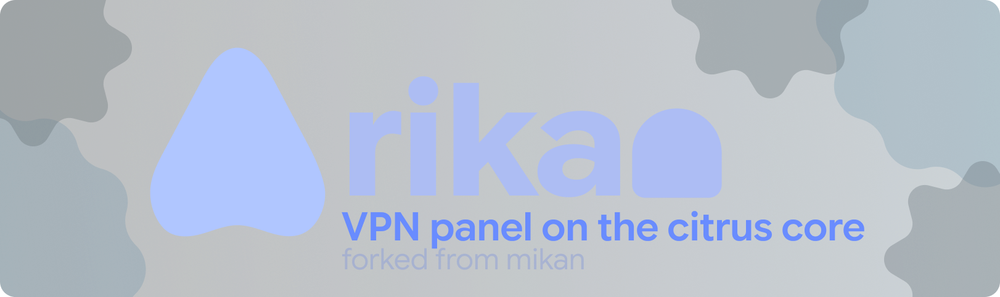
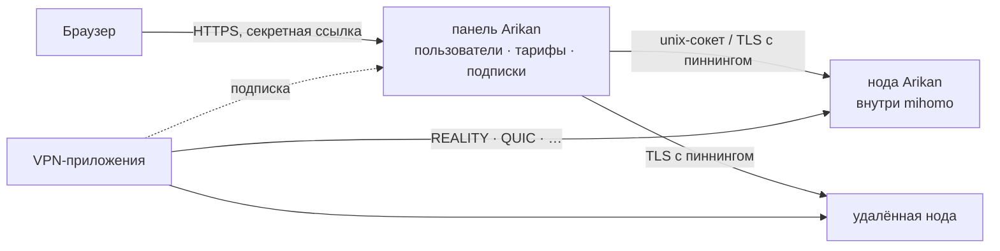

<div align="center">



<br>

**Быстрая и красивая VPN-панель на ядре [mihomo](https://github.com/MetaCubeX/mihomo): ставится одной командой и не требует присмотра.**

[](https://github.com/o0hhs/arikan/releases)
[](https://github.com/o0hhs/arikan/pkgs/container/arikan)
[](LICENSE)
[](https://github.com/MetaCubeX/mihomo)

[English](README.md) · **Русский** · [简体中文](README.zh-CN.md) · [فارسی](README.fa.md) · [Türkçe](README.tr.md) · [Español](README.es.md)

<sub>Форк [mikan](https://github.com/Miroshka000/mikan): всё из апстрима плюс реферальная программа, метки рекламных кампаний, домен подписки и ещё несколько своих вещей. Релизы форка — свои, с собственной подписью.</sub>

</div>

---

> [!IMPORTANT]
> **Неофициальный форк.** Arikan не связан с проектом mikan и не поддерживается им. Поддержка — только у автора форка.

## Установка

На чистом сервере с Ubuntu 22.04+ или Debian 12+ (amd64 или arm64):

```bash
curl -fsSL https://github.com/o0hhs/arikan/releases/latest/download/install.sh | sudo bash
```

Установщик по шагам:
1. Спрашивает язык панели и, если нужно, домен. Проверяет, что домен указывает на этот сервер.
2. Ставит Docker, если его нет.
3. Подбирает сайты для маскировки REALITY рядом с сервером.
4. В конце выдаёт ссылку на админку.

Меню управления потом открывается командой `arikan`.

Нода для уже работающей панели: страница **Ноды** в панели (или `arikan node add`) выдаёт команду с ключом:

```bash
curl -fsSL https://github.com/o0hhs/arikan/releases/latest/download/install.sh | sudo bash -s -- --join КЛЮЧ
```

Без вопросов, для скриптов: `… | sudo bash -s -- --yes --lang ru --domain vpn.example.com --email you@example.com` (все флаги: `arikan install --help`).

### Переход с обычного mikan

Уже стоит панель апстрима — переезд это просто переключение образа, данные остаются как были: форк добавляет только свои новые таблицы (все пустые), ни одна существующая строка не переписывается, а недостающие миграции панель применяет сама при первом старте.

**1. Обычный mikan.** Если панель ещё не стоит, сначала штатная установка — она же ставит Docker, файрвол и compose:

```bash
curl -fsSL https://github.com/Miroshka000/mikan/releases/latest/download/install.sh | sudo bash
```

**2. Переключение на форк.** Одна команда — она берёт свежий стабильный релиз из подписанного указателя релизов форка и проверяет его подпись:

```bash
curl -fsSL https://raw.githubusercontent.com/o0hhs/arikan/main/scripts/install-fork.sh | sudo bash
```

Панель старше 0.5.0.0 (ещё на SQLite) сначала обновляется до 0.5.x штатным установщиком: этот скрипт работает с панелью на PostgreSQL.

**Нода** (сервер, где из `/opt/mikan/compose.yaml` поднята только служба `node`) переходит этой же командой: панели, postgres и pg_dump там нет, и скрипт это учитывает. Роль он видит по `MIKAN_MODE=node` в `/opt/mikan/.env`, а если строки нет — по самому compose.yaml. На ноде вместо копии базы снимается архив её собственных данных (`/opt/mikan/data/node/backup/backup-<дата>-before-fork.tar.gz`: ключи, настройки, соединения), схема и таблицы `referral_*`/`campaign_*` не проверяются (их создаёт панель на своей стороне), а обновления ведёт панель через страницу **Nodes**. Если у панели несколько адресов и нода сама не угадывает нужный, добавьте `--node-panel-address IP`.

Что делает скрипт (`scripts/install-fork.sh`):

- читает указатель релизов и манифест форка, сверяет их подпись ключом форка и берёт образ из манифеста — пином по digest (`--image ghcr.io/o0hhs/arikan:<тег>` называет другой образ: бету или свою сборку);
- сначала тянет образ: если что-то не так (пакет ещё закрыт, нет доступа в реестр) — ничего не меняется, стек как работал;
- ставит на хост команду форка и её юниты обновления **до** переключения образа и лишь затем выключает стоковый апдейтер: стоковая команда остаётся в `/usr/local/bin/mikan.stock`, файлы её юнитов — на месте. Без этого кнопка **«Обновить»** в панели и ночной таймер по-прежнему ходили бы к апстриму и однажды положили обычный mikan поверх форка;
- делает резервную копию — базы (pg_dump) на панели, данных ноды (tar) на ноде — и `.env`;
- переключает образ и перезапускает стек, назвав службу по роли (`panel` или `node`), и сначала убедившись, что такая служба в `compose.yaml` вообще есть;
- на панели сверяет схему базы, число клиентов, тарифов, платежей; на ноде — что она отвечает своей командой; в обоих случаях проверяет, что апдейтер на хосте — форка: проверка не прошла — скрипт сам откатывается;
- автообновление оставляет включённым: у форка свой адрес релизов и свой ключ подписи, панель не «вернёт себя» на апстрим. Ключ `--disable-auto-update` нужен только для старых сборок форка, у которых адрес релизов ещё указывал на апстрим.

Посмотреть, что скрипт собирается сделать, не меняя ничего: тот же запрос с `--dry-run`. Если образ не скачивается — откройте пакет: GitHub → Packages → arikan → Package settings → Change visibility → Public (скрипт сам подскажет это на неудаче).

**3. После перехода.** На странице **Платежи** включите реферальную программу («Рефералы») и создайте метки кампаний. Всё остальное — пользователи, тарифы, платежи, ноды, ссылки подписок — без изменений.

**Откат на обычный mikan** — та же команда с копией, снятой до перехода (платежи, клиенты и тарифы вернутся к состоянию на её момент; данные реферальной программы и меток кампаний в копию не входят). Вместе с ней возвращаются стоковая команда и её юниты обновления:

```bash
curl -fsSL https://raw.githubusercontent.com/o0hhs/arikan/main/scripts/install-fork.sh | sudo bash -s -- --rollback /opt/mikan/data/panel/backup-<дата>-before-fork.dump
```

На ноде копия — это архив её данных, и откат называется так же (скрипт сам смотрит на расширение: `.dump` — панель, `.tar.gz` — нода):

```bash
curl -fsSL https://raw.githubusercontent.com/o0hhs/arikan/main/scripts/install-fork.sh | sudo bash -s -- --rollback /opt/mikan/data/node/backup-<дата>-before-fork.tar.gz
```

## Чем форк отличается от официального mikan

Официальный mikan живёт в [Miroshka000/mikan](https://github.com/Miroshka000/mikan). Этот репозиторий — форк: панель апстрима со всем, что она умеет, плюс несколько своих вещей. За апстримом следят: его релизы переносятся сюда, поэтому исправления и новинки официальной панели здесь тоже появляются (сейчас перенесён 0.5.1.0).

Своего у форка:

- **Реферальная программа** (Платежи → Рефералы): приглашения по ссылке бота, баланс пригласившего, правила вознаграждения по тарифам. Подробно ниже.
- **Метки рекламных кампаний** (Платежи → Кампании): ссылка с меткой на каждую рекламу и счётчики по ней. Подробно ниже.
- **Домен подписки** (Настройки → Подписка): ссылки подписок на своём домене или поддомене, отдельно от адреса панели. Сертификат панели выпускается сразу с этим именем, а можно отдать домен своему прокси или CDN — он даже не обязан указывать на сервер. Переезд панели больше не ломает ссылки: вслед за ними меняется только DNS.
- **Копирование протоколов** (Протоколы → протокол → Копировать): поднять тот же протокол с теми же ключами и маскировкой на другом порту или на другой ноде, поменяв только порт и, у REALITY, сайт маскировки.
- **VK TURN** (карточка ноды → ⋯ → VK TURN): там, где белый список пропускает только звонки, нода несёт выбранное подключение через TURN-серверы звонков VK, а в подписке оно появляется ещё раз — обычным сервером на адресе самого клиента.
- **Завершение переезда панели**: после восстановления из бэкапа на новом сервере `arikan admin migrate` назначает новый адрес, сохраняет ссылки подписок и проверяет ноды — они принимают переехавшую панель без перерегистрации.
- **Свой канал обновлений**: образ `ghcr.io/o0hhs/arikan`, релизы на этой странице, манифест подписан ключом форка, и `arikan update` с кнопкой **Обновить** ходят сюда, а не к апстриму. Документация — [o0hhs.github.io/arikan](https://o0hhs.github.io/arikan).

О том, как апстрим относится к чужим сборкам, — честно написано в разделе [«Форки и чужие сборки»](#-форки-и-чужие-сборки): сверьте то, что запускаете, и запускайте то, чей код можно прочитать.

## Почему Arikan

<table>
<tr>
<td width="50%" valign="top">

### 🛡️ Сама переживает блокировки
Arikan следит, доходят ли реальные клиенты до каждого протокола:
- если по дороге заблокировали порт, панель переносит протокол на свободный HTTPS-порт;
- если сайт маскировки REALITY перестал подходить, подбирает новый рядом с сервером.

</td>
<td width="50%" valign="top">

### 📱 Каждому приложению — то, что работает
Подписка узнаёт приложение: Happ, v2RayTun, Koala Clash, SlothClash, Clash Verge, FlClash, ClashFest, Hiddify, Shadowrocket и другие. Каждому она отдаёт только те протоколы, которые оно умеет. Никаких «у меня не работает».

</td>
</tr>
<tr>
<td valign="top">

### 📊 Учёт до байта
mihomo встроен как библиотека, поэтому трафик считается по каждому соединению каждого пользователя, а не выборочно.
- Тарифы по сроку и гигабайтам, день оплаты.
- Лимит устройств и привязка к устройствам против перепродажи ключа.
- Блокировка торрентов: каждое соединение известно по пользователю, поэтому бан получает тот, кто качает, сразу на всех нодах, а не общий IP.

</td>
<td valign="top">

### 🤖 Telegram-бот и Mini App внутри
Бот настраивается прямо в панели. В нём подписчики:
- видят тариф, устройства и инструкции;
- открывают страницу подписки как Mini App;
- получают напоминания до конца срока;
- покупают и продлевают подписку: Telegram Stars, карта или СБП через ЮKassa, криптовалюта через CryptoBot — панель выдаёт ссылку сама.

Рассылки идут с учётом лимитов Telegram.

</td>
</tr>
<tr>
<td valign="top">

### 🪶 Лёгкая, как пёрышко
Go и PostgreSQL, три небольших контейнера. На рабочем сервере с клиентами:
- панель — **~14 МБ ОЗУ**;
- база — **~50 МБ ОЗУ**;
- ядро VPN — **~40 МБ ОЗУ**.

</td>
<td valign="top">

### 🔒 Закрыта по умолчанию
- Секретная ссылка на админку на случайном порту.
- HTTPS с Let's Encrypt, даже для голого IP.
- Пароли на argon2id, 2FA (TOTP), защита от CSRF, строгий CSP, журнал аудита.
- Контейнеры без root, только для чтения, со сброшенными привилегиями.

</td>
</tr>
<tr>
<td valign="top">

### 🌐 WARP и каскад серверов
У каждой ноды может быть свой WARP — регистрация в один клик или свой WireGuard-конфиг, — а подключения могут выходить через другую ноду панели (клиент → нода A → нода B → интернет). Выбранные подключения, домены и сети идут этими путями, остальное — напрямую.

</td>
<td valign="top">

### 🧩 API и ключи для интеграций
REST API с документацией прямо в панели, ключи с правами «только чтение» или «полный доступ» для ботов, биллинга и мониторинга.

</td>
</tr>
</table>

## Промокоды

Администратор может создавать скидочные промокоды и коды на бонусные дни или трафик.
Подписчики активируют их в Telegram Mini App и видят историю активаций. Бонусный трафик
можно начислить в основной баланс или выбранный пул. Скидочные счета доступны только
через способы оплаты с поддержкой возврата: Telegram Stars и адаптеры, которые заявили
такую возможность. Тогда Arikan сможет вернуть оплату, если резерв промокода истёк до
подтверждения платежа провайдером.

## Реферальная программа

Подписчики приглашают других своей ссылкой (`t.me/<бот>?start=ref_<код>`). Telegram-аккаунт
навсегда закреплён за одним пригласившим, поэтому приглашённого нельзя посчитать дважды.
Что получает пригласивший, задают правила, которые администратор пишет по тарифам: процент
на внутренний баланс, бонусные дни к своей подписке или и то и другое, плюс правило с
порогом «каждая N-я оплата». Балансом можно частично оплатить счёт. Программа включается,
правила и тарифы задаются на странице **Платежи → Рефералы** в панели.

## Метки рекламных кампаний

Дайте каждой рекламе свою ссылку (`t.me/<бот>?start=camp_<метка>`) — и панель посчитает по
каждой кампании, сколько людей пришло, сколько купило и сколько продлило. Статистика на
той же странице **Платежи**, так что окупаемость кампании видно прямо в панели, а не только
в рекламной сети.

## Протоколы

Семнадцать протоколов, для каждого есть готовый пресет, ключи генерируются сами. Подписка отдаёт каждому приложению только то, что оно запускает:

| Протокол | Clash-приложения<br><sub>ядро mihomo</sub> | Приложения на Xray<br><sub>Happ, v2RayTun</sub> | Приложения на sing-box<br><sub>Hiddify, Karing</sub> |
|---|:---:|:---:|:---:|
| VLESS · REALITY · Vision | ✅ | ✅ | ✅ |
| VLESS · REALITY · XHTTP | ✅ | ✅ | — |
| VLESS · REALITY · gRPC | ✅ | ✅ | ✅ |
| VLESS PQ (постквантовое шифрование) | ✅ | ✅ | — |
| Trojan · REALITY | ✅ | ✅ | ✅ |
| VLESS · TLS · XHTTP | ✅ | ✅ | — |
| VLESS · TLS · Vision | ✅ | ✅ | ✅ |
| Hysteria2 | ✅ | ✅ | ✅ |
| TUIC v5 | ✅ | — | ✅ |
| AnyTLS | ✅ | — | ✅ |
| TrustTunnel | ✅ | — | — |
| ShadowQUIC | ✅ | — | — |
| Mieru | ✅ | — | — |
| Shadowsocks-2022 ¹ | ✅ | ✅ | ✅ |
| Sudoku ¹ | ✅ | — | — |
| Snell ¹ | ✅ | — | — |
| VMess (свой конфиг) | ✅ | ✅ | ✅ |

<sub>¹ В mihomo у этих протоколов один ключ на всех, поэтому учёта и лимитов по пользователям на них нет. Новые протоколы Clash-приложение получает, только если его ядро достаточно свежее.</sub>

## Как это устроено



Панель и нода — два процесса из одного образа. Обновление или перезапуск панели не роняет VPN. Удалённые ноды добавляются по ключу со страницы **Ноды**.

## Управление сервером

Команда `arikan` открывает меню. Команды можно вызывать и напрямую, они на английском:

| Команда | Что делает |
|---|---|
| `arikan status` | контейнеры, версии, состояние, доступное обновление |
| `arikan logs [panel\|node]` | логи в реальном времени |
| `arikan url` | ссылка на админку |
| `arikan reset-password` · `reset-path` · `disable-2fa` | вернуть доступ |
| `arikan update` | обновить сейчас: сначала бэкап, при сбое откат |
| `arikan backup` · `restore FILE` | бэкапы в `/opt/mikan/backups` |
| `arikan admin migrate --public-host IP` | завершить переезд панели после восстановления на новом сервере: новый адрес, ссылки те же, ноды проверяются |
| `arikan node …` · `arikan inbound …` | ноды и протоколы |
| `arikan targets scan` · `apply` | сайты для маскировки REALITY рядом с сервером |
| `arikan join КЛЮЧ` | на ноде: взять новый ключ из панели |
| `arikan restart` | перезапустить контейнеры |
| `arikan uninstall` | остановить и удалить команду, данные остаются |

## Обновления

Панель раз в день проверяет новый релиз и показывает, что изменилось. Автообновление включается в настройках, обновиться сразу можно кнопкой **Обновить**.

Обновление делает программа на хосте:
1. Берёт образ из GitHub Packages.
2. Делает бэкап.
3. Обновляет базу и перезапускает панель.
4. Если новая версия не поднялась, откатывается.

Манифест каждого релиза подписан.

На 0.4.4 и более ранних версиях сначала обновитесь до 0.4.5, тогда переход на 0.5 с PostgreSQL тоже пройдёт кнопкой. Пропустили 0.4.5 — подойдёт команда из «Установки», она обновит существующий сервер.

## Сборка из исходников

```bash
docker buildx build -t arikan:dev .            # образ панели и ноды
cd web && pnpm install && pnpm dev            # админка с горячей перезагрузкой
MIKAN_TEST_DATABASE_URL=postgres://… go test ./...   # Go 1.27, тестовая PostgreSQL 18 и pg_dump
cd installer && cargo test                    # установщик (Rust)
```

Разработка идёт в ветке `main`. Пулл-реквесты собираются и проходят тесты, релизы публикуются по тегам.

## ⛔ Форки и чужие сборки

> [!CAUTION]
> **Официальный mikan есть только здесь:** репозиторий `Miroshka000/mikan`, образ `ghcr.io/miroshka000/mikan` и релизы, подписанные ключом mikan. Аддоны — только из каталога `getmikan/marketplace`. Всё остальное — не mikan, как бы оно ни называлось.
>
> **Проект mikan считает любой форк и любую сборку не из официальных источников потенциально небезопасными.**
>
> **Официальные сборки можно проверить.** Каждый релиз собирается автоматически из открытого кода этого репозитория и подписывается, а панель и установщик принимают обновления только с этой подписью. Из чего собрана чужая сборка, знает только её автор.
>
> **Форк не получает наших обновлений.** Подписать релиз ключом mikan форк не может, поэтому исправления ошибок и уязвимостей до него не доходят, пока их не перенесёт автор форка, если перенесёт.
>
> **Форки мы не поддерживаем.** Мы не проверяем их и не отвечаем за ошибки, уязвимости и потерю данных в них. Вопросы о чужих сборках в чате и в issues не рассматриваются.
>
> **Название не входит в лицензию.** GPL v3 даёт права на код, но не на название mikan и логотип (п. 7 GPL v3, подробнее в [NOTICE.md](NOTICE.md) и [TRADEMARK.md](TRADEMARK.md)). Форк должен называться по-другому и не выдавать себя за mikan.

## Лицензия

Arikan — форк mikan, свободная программа под [GNU GPL v3](LICENSE) с дополнительными условиями из [NOTICE.md](NOTICE.md): сохранять указание авторства, не выдавать изменённую версию за оригинал, права на исходное название и логотип не передаются. Copyright (C) 2026 Miroshka and Mikan. Внутри [mihomo](https://github.com/MetaCubeX/mihomo) (GPL-3.0), часть кода взята из [3x-ui](https://github.com/MHSanaei/3x-ui) (GPL-3.0). Шрифты: Unbounded, Onest, JetBrains Mono (SIL OFL 1.1).

<div align="center">
<sub>Arikan — неофициальный форк mikan</sub>
</div>
